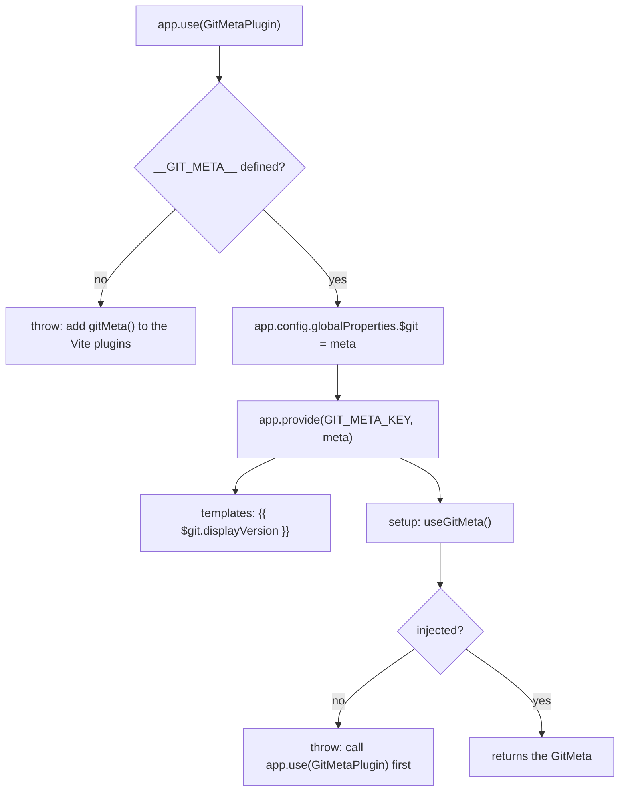

# Public API

Everything below is public. Any other export or file is internal and may change.

## Entry point `vite-plugin-git-meta`

```ts
export function gitMeta(options?: GitMetaOptions): Plugin // also the default export
export function collectGitMeta(
  options?: GitMetaOptions,
  cwd?: string,
  run?: CommandRunner,
  env?: Record<string, string | undefined>,
): GitMeta
export const DEFAULT_COMMANDS: Record<GitCommandName, string>
export type { GitCommandName, GitMeta, GitMetaOptions }
```

`gitMeta()` is the way to use the package. `collectGitMeta` and `DEFAULT_COMMANDS` are exported for scripts and tests that want the same data outside Vite (for example a script that prints the version before a build).

### `GitMeta`

```ts
interface GitMeta {
  version: string
  tag: string | null
  branch: string
  commit: string
  shortCommit: string
  displayVersion: string
  commitDate: string
  buildDate: string
  dirty: boolean
  commitsSinceTag: number | null
}
```

Field semantics and fallbacks: [behavior](behavior.md).

### `GitMetaOptions`

| Option           | Type                                                | Default                               |
| ---------------- | --------------------------------------------------- | ------------------------------------- |
| `cwd`            | `string`                                            | Vite `root`, then `process.cwd()`     |
| `version`        | `string`                                            | `npm_package_version`, then `'0.0.0'` |
| `commands`       | `Partial<Record<GitCommandName, string>>`           | `DEFAULT_COMMANDS`                    |
| `displayVersion` | `(meta: Omit<GitMeta, 'displayVersion'>) => string` | tag, else `branch#shortCommit`        |
| `versionFile`    | `boolean                                            | string`                               | `false` |

`GitCommandName` is `'branch' | 'tag' | 'commit' | 'shortCommit' | 'commitDate' | 'describe' | 'dirty'`. `commands` entries are merged over the defaults: giving only `tag` keeps the others.

`versionFile`: `true` emits the metadata as `version.json` at build and serves it at that URL in dev, a string sets the file name (a leading slash is dropped).

### Global constant

The package declares `const __GIT_META__: GitMeta` globally in its type definitions. It is available in the app as soon as the package types are part of the TypeScript program, for example with `/// <reference types="vite-plugin-git-meta" />`.

## Entry point `vite-plugin-git-meta/vue`

```ts
export const GitMetaPlugin: Plugin // also the default export
export function useGitMeta(): GitMeta
export const GIT_META_KEY: InjectionKey<GitMeta>
```



The module augments Vue's `ComponentCustomProperties` with `$git: GitMeta`. The augmentation is only active when `vite-plugin-git-meta/vue` is part of the program (it is, as soon as `main.ts` imports `GitMetaPlugin`).

## Compatibility

| Item   | Supported                         |
| ------ | --------------------------------- |
| Node   | `>= 20`                           |
| Vite   | `>= 5` (peer dependency)          |
| Vue    | `^3.3` (optional peer dependency) |
| Module | ESM only                          |

## Versioning

Semantic versioning. While the version is `0.x`, a breaking change bumps the minor. Breaking means: removing or renaming an export, an option or a `GitMeta` field, changing a default or a fallback value, or raising the minimum Node or Vite version.
