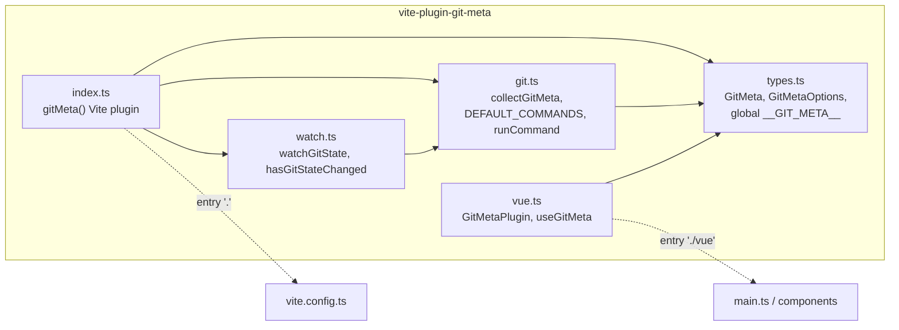
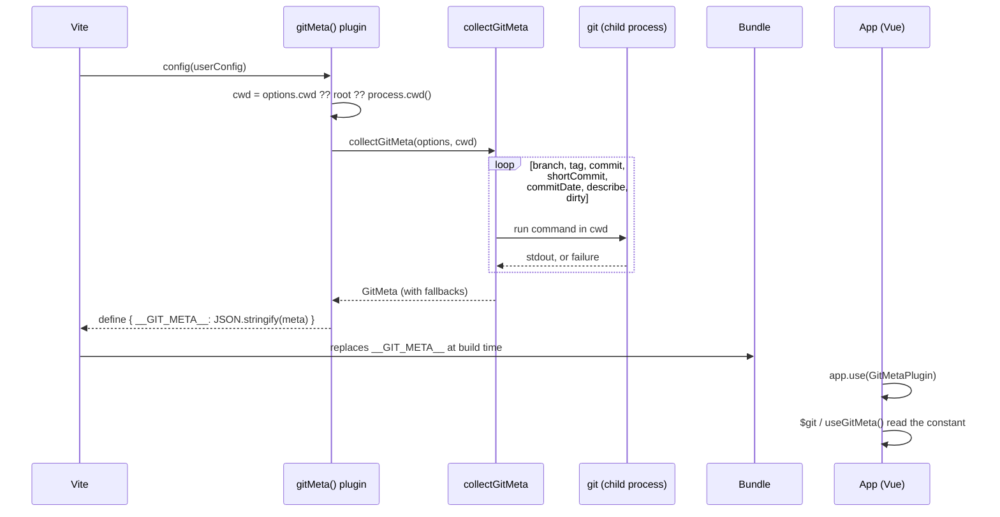
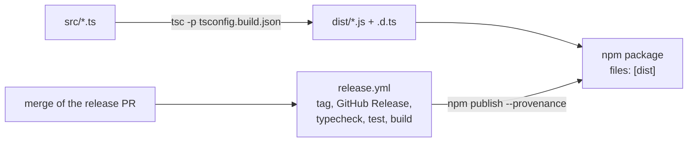
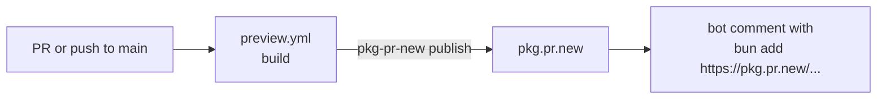

# Architecture

## Modules

Dependency rules:

1. `git.ts` has no Vite and no Vue import. It receives a `CommandRunner`, which makes it testable without git.
2. `index.ts` is a thin Vite wrapper: it resolves the working directory, calls `collectGitMeta`, emits or serves the version file and restarts the dev server through `watch.ts`.
3. `vue.ts` is the only file importing `vue`, an optional peer dependency. `index.ts` and `git.ts` must never import it.

## Data flow

The metadata is computed once, when Vite loads its config, and baked into the bundle as a constant.

At run time there is no git, no Node and no network involved: `__GIT_META__` is a literal object in the bundle.

## Distribution

Every pull request and push to `main` also runs `preview.yml`, which builds and publishes a preview to pkg.pr.new (a bot comments the install command on the PR). Nothing from this path reaches npm.

The release flow is detailed in [release](release.md). Output is ESM only. The `exports` map has two entries: `.` (plugin, types) and `./vue`.
