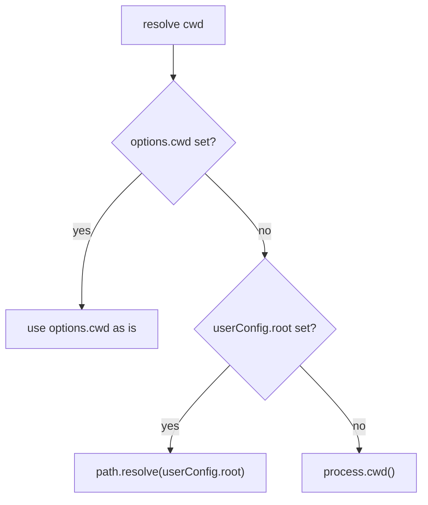
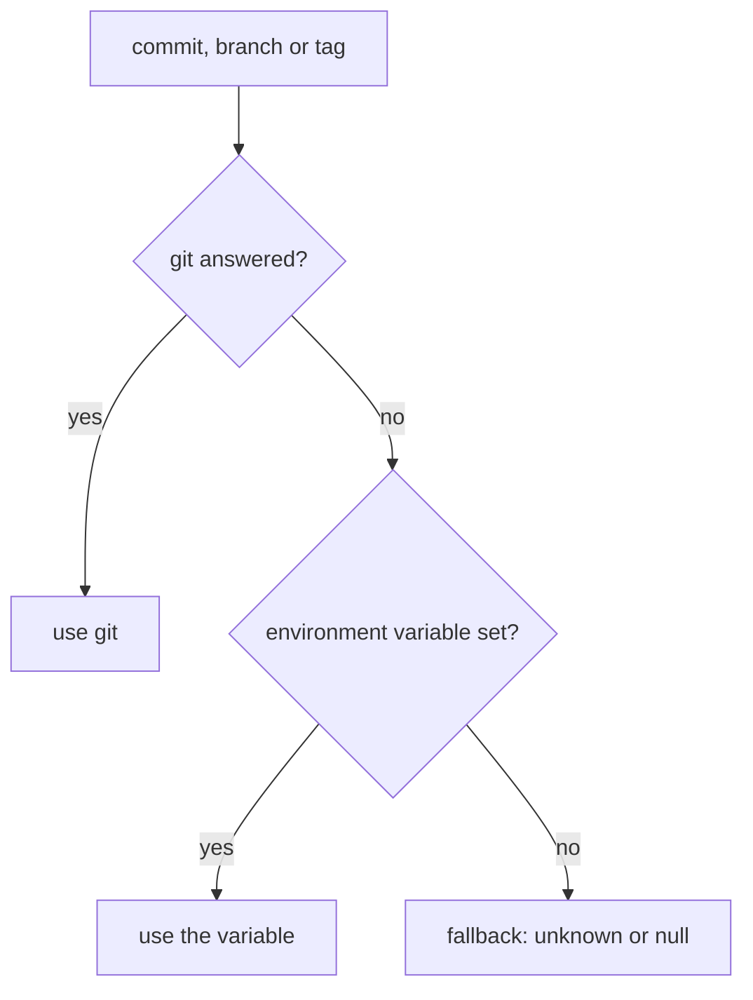
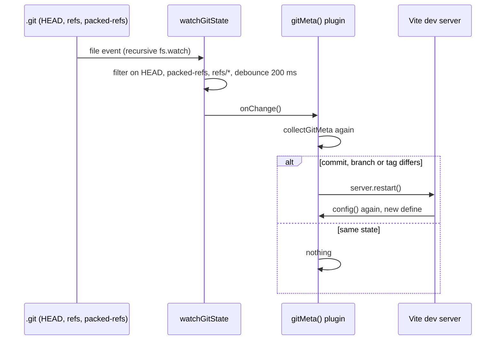
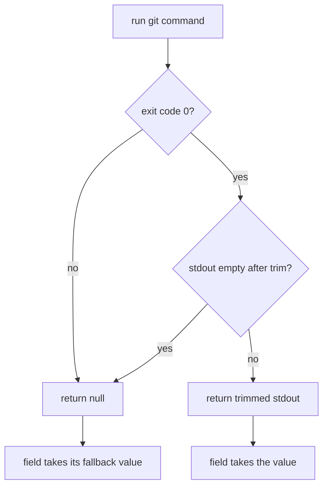

# Behavior

## When the data is computed

`gitMeta()` returns a Vite plugin with a `config` hook. The hook runs once per Vite config load, for `vite build` and for `vite dev` alike. The result is injected with `define`, so every use of `__GIT_META__` in the app is replaced by the same JSON literal.

Consequence: the value is fixed when the config loads. In `vite dev` the plugin keeps it fresh by restarting the server, see [Dev refresh](#dev-refresh).

## Working directory

## Fields

Each git field comes from one command, run through the shell in the resolved `cwd`. Output is trimmed. Empty output counts as a failure.

| Field             | Default command                      | Fallback when the command fails or prints nothing        |
| ----------------- | ------------------------------------ | -------------------------------------------------------- |
| `branch`          | `git rev-parse --abbrev-ref HEAD`    | `'unknown'`                                              |
| `tag`             | `git describe --tags --exact-match`  | `null`                                                   |
| `commit`          | `git rev-parse HEAD`                 | `'unknown'`                                              |
| `shortCommit`     | `git rev-parse --short HEAD`         | `'unknown'`                                              |
| `commitDate`      | `git log -1 --format=%cd --date=iso` | build date as an ISO 8601 string                         |
| `dirty`           | `git status --porcelain`             | `false` (any output means `true`, untracked files count) |
| `commitsSinceTag` | `git describe --tags --long`         | `null` (N parsed from `<tag>-N-g<hash>`)                 |

The two other fields do not use git:

| Field            | Value                                                                                      |
| ---------------- | ------------------------------------------------------------------------------------------ |
| `version`        | `options.version`, else `process.env.npm_package_version`, else `'0.0.0'`                  |
| `buildDate`      | `new Date().toISOString()` at the time the hook runs                                       |
| `displayVersion` | `options.displayVersion(meta)` if given, else `tag`, else `` `${branch}#${shortCommit}` `` |

`displayVersion` receives every other field, with the fallbacks already applied. `npm_package_version` is only set when Vite is started through a package manager script (`bun run build`, `npm run build`), so pass `version` explicitly when it is launched another way.

## CI environment fallback

When a git command fails, `commit`, `branch` and `tag` are looked up in the environment, so a Docker build without `.git` or a CI checkout does not report `unknown`. Git always wins when it answers.

| Field  | Variables, first set wins                                                                                                                                                        |
| ------ | -------------------------------------------------------------------------------------------------------------------------------------------------------------------------------- |
| commit | `GIT_COMMIT`, `GITHUB_SHA`, `CI_COMMIT_SHA`, `VERCEL_GIT_COMMIT_SHA`, `CF_PAGES_COMMIT_SHA`                                                                                      |
| branch | `GIT_BRANCH`, `GITHUB_HEAD_REF`, `CI_COMMIT_BRANCH`, `CI_COMMIT_REF_NAME`, `VERCEL_GIT_COMMIT_REF`, `CF_PAGES_BRANCH`, then `GITHUB_REF_NAME` when `GITHUB_REF_TYPE` is `branch` |
| tag    | `GIT_TAG`, `CI_COMMIT_TAG`, then `GITHUB_REF_NAME` when `GITHUB_REF_TYPE` is `tag`                                                                                               |

`shortCommit` falls back to the first 7 characters of `commit`. A detached HEAD (`git rev-parse --abbrev-ref HEAD` prints `HEAD`) counts as no branch, so the environment is used.

## Version file

With `versionFile`, the plugin emits the metadata as a JSON asset in `generateBundle` (every build environment gets it) and serves it from a dev middleware at `<base><file>`. The content is the exact object injected in `define`.

## Dev refresh

The metadata lives in `define`, which Vite reads when the config loads, so a restart is the only way to refresh it. Edits to the working tree are not watched: `dirty` and `commitsSinceTag` are refreshed by the next restart. The watcher is unref'd and closed with the HTTP server. If the directory cannot be watched, the feature silently turns off.

## Failure handling

- Nothing in this path throws: not a repository, git not installed, no commit yet, no tag, bad custom command.
- stderr is discarded (`stdio: ['ignore', 'pipe', 'ignore']`), so a missing tag does not print `fatal: no tag exactly matches` in the build log.
- A failing field never affects the others.

## Edge cases

| Situation                              | Result                                                                                                                |
| -------------------------------------- | --------------------------------------------------------------------------------------------------------------------- |
| Detached HEAD (typical in CI on a tag) | `branch` comes from the environment, else `'unknown'`. `tag` is set if HEAD is tagged, so `displayVersion` is the tag |
| HEAD has several tags                  | Git picks one for `describe`. Override `commands.tag` to choose                                                       |
| Shallow clone without tags             | `tag` is `null`. Fetch tags (`fetch-depth: 0` in GitHub Actions)                                                      |
| Repository with no commit              | `commit`, `shortCommit` fall back to `'unknown'`, `commitDate` to the build date                                      |
| Not a git repository                   | Every git field falls back, the build succeeds                                                                        |
| Branch name with quotes or newlines    | Safe: the object goes through `JSON.stringify`                                                                        |
| Custom command with a bad exit code    | Treated as a failure, the field uses its fallback                                                                     |

## Security notes

`commands` strings are executed by a shell. They come from the project's own `vite.config`, which is trusted code, so there is no sanitisation. Never build them from untrusted input (a branch name, an environment variable set by a contributor).

## Known limits

- `dirty` counts untracked files, so a build output folder that is not git-ignored makes it `true`.
- The dev refresh needs recursive `fs.watch`, available on Linux since Node 20, and on macOS and Windows.
- `commitDate` uses git's `iso` format (`2025-12-31 10:00:00 +0100`), which is ISO-like but not strict ISO 8601. Only the fallback is a strict ISO string.
- Monorepos: git runs in the Vite root, so a package in a subfolder reports the commit of the whole repository, not the last commit touching that package.
