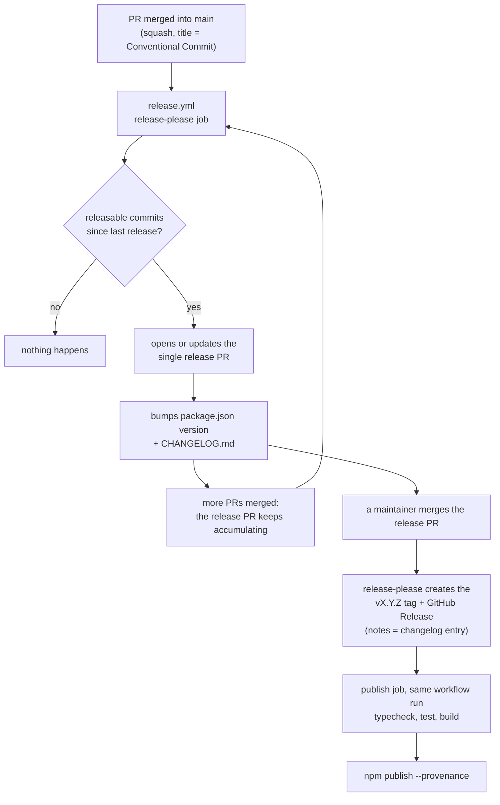

# Release

Releases are automated with [release-please](https://github.com/googleapis/release-please). Nobody edits `version` in `package.json` or writes the changelog by hand: both come from the commit messages.

## Flow

Merging a bugfix does **not** publish anything. Merged changes pile up in one open release PR, and the release happens only when a maintainer merges that PR. Ten fixes merged in a row make one version, not ten.

## What lives where

| Artifact               | Where it comes from                                                     |
| ---------------------- | ----------------------------------------------------------------------- |
| `package.json` version | Bumped in the release PR, lands on `main` when the release PR is merged |
| `CHANGELOG.md`         | Entry added in the release PR, same merge                               |
| Git tag `vX.Y.Z`       | Created by release-please at the release PR merge                       |
| GitHub Release         | Created at the same time, its notes are the changelog entry             |
| npm package            | Published by the `publish` job of the same workflow run                 |
| Per-PR dev build       | `preview.yml` (pkg.pr.new), unrelated to releases                       |

## Version bump

Derived from the Conventional Commits merged since the last release.

| Commit                                           | Bump while `0.x`   | Bump from `1.0`    |
| ------------------------------------------------ | ------------------ | ------------------ |
| `fix:`, `perf:`                                  | patch              | patch              |
| `feat:`                                          | minor              | minor              |
| `feat!:`, `fix!:` or a `BREAKING CHANGE:` footer | minor              | major              |
| `docs:`, `refactor:`                             | no release alone   | no release alone   |
| `build:`, `ci:`, `test:`, `style:`, `chore:`     | hidden, no release | hidden, no release |

Changelog sections: Features, Bug Fixes, Performance, Reverts, Documentation, Refactoring. Hidden types appear in no entry. Config lives in `release-please-config.json`, the last released version in `.release-please-manifest.json`.

The first release is `0.1.0`: the manifest and `package.json` start at `0.0.0`, and the first `feat:` bumps the minor.

To force a version, add a `Release-As: 1.0.0` footer to a commit message on `main`. The release PR then targets that version.

## Pre-releases

Not a per-run choice. A pre-release line is configured in `release-please-config.json` (`"prerelease": true`, `"prerelease-type": "rc"`), usually on a dedicated branch, and it publishes versions such as `1.3.0-rc.0`. Because `npm publish` runs without `--tag`, a pre-release would take the `latest` dist-tag, so add a `--tag` for it before using this.

## Conventions this relies on

- Merge pull requests with **squash**, and let the PR title become the commit message. `pr-title.yml` fails a PR whose title is not a Conventional Commit.
- Breaking changes use `!` after the type or a `BREAKING CHANGE:` footer, so they show in the changelog and bump the version.

## Setup (once)

1. Repository settings, Actions, General: enable **Allow GitHub Actions to create and approve pull requests**.
2. Add the `NPM_TOKEN` secret (an npm automation token able to publish the package).
3. Optional: add a `RELEASE_PLEASE_TOKEN` secret (a fine-grained PAT or a GitHub App token with contents and pull-requests write). Without it, the release PR is opened with `GITHUB_TOKEN` and `ci.yml` and `preview.yml` do not run on it. With it, they do.
4. Optional: set the repository's merge button to squash only.

## Known limits

- Without `RELEASE_PLEASE_TOKEN`, pull requests and tags created with the default `GITHUB_TOKEN` do not trigger other workflows, so `ci.yml` does not run on the release PR. The publish job therefore runs typecheck, tests and build itself before publishing.
- Publishing happens in the same workflow run that created the release, because a tag created by `GITHUB_TOKEN` would not trigger a separate tag-based workflow.
- If `npm publish` fails after the tag exists, fix the cause and re-run the failed `publish` job from the Actions tab. Do not delete the tag.
