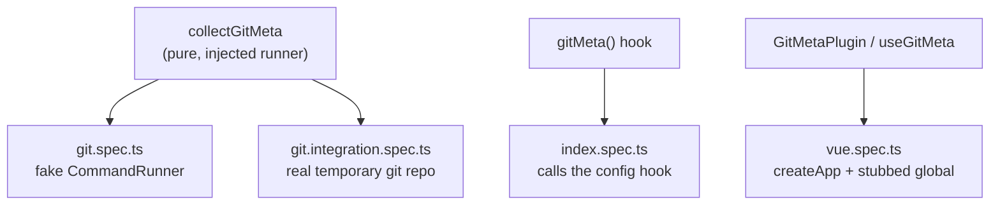

# Testing

Vitest, specs in `src/__tests__/`, run with `bun run test`.

## Strategy

Logic is tested through the injected `CommandRunner`, never by mocking `child_process`. Real git behaviour is covered once, in the integration spec.

## What each file guarantees

| File                      | Guarantees                                                                                                                                   |
| ------------------------- | -------------------------------------------------------------------------------------------------------------------------------------------- |
| `git.spec.ts`             | Every field is read, `displayVersion` default and custom, fallbacks outside git, `version` precedence, command override and `cwd` forwarding |
| `git.integration.spec.ts` | On a real repo: branch and hash, tag detection, fallback outside a repository                                                                |
| `index.spec.ts`           | Plugin name, `define.__GIT_META__` is valid JSON with all eight fields, `cwd` precedence (option, Vite root)                                 |
| `vue.spec.ts`             | `$git` and `useGitMeta()` return the meta, clear errors when the Vite plugin or `app.use` is missing                                         |

## Rules

- A bug fix comes with a test that fails without the fix.
- Time goes through fake timers (`vi.useFakeTimers`), never the wall clock.
- The integration spec creates its repository in `os.tmpdir()`, sets its own `user.name`, `user.email` and `commit.gpgsign`, and removes it afterwards. It must not depend on the developer's global git config or on the checkout it runs in.
- CI runs the suite on Node 20, 22 and 24, with full history (`fetch-depth: 0`).
